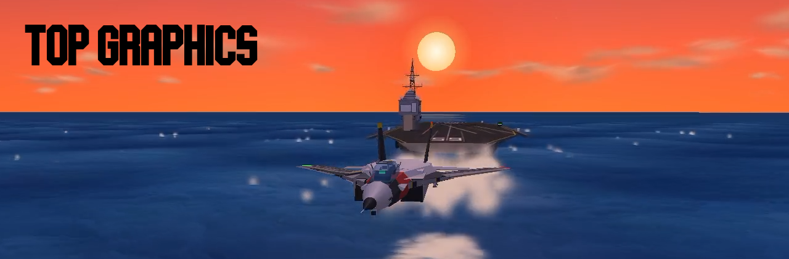
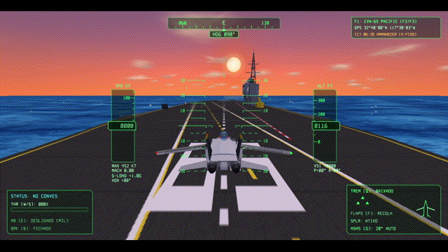
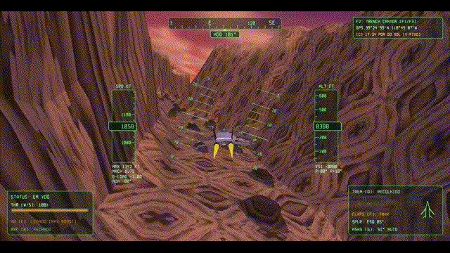
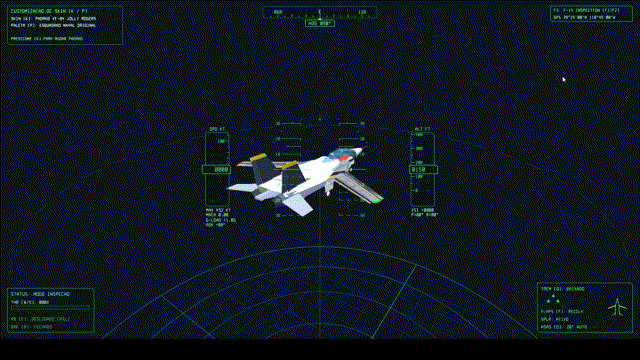
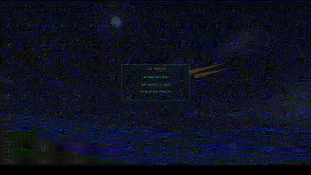
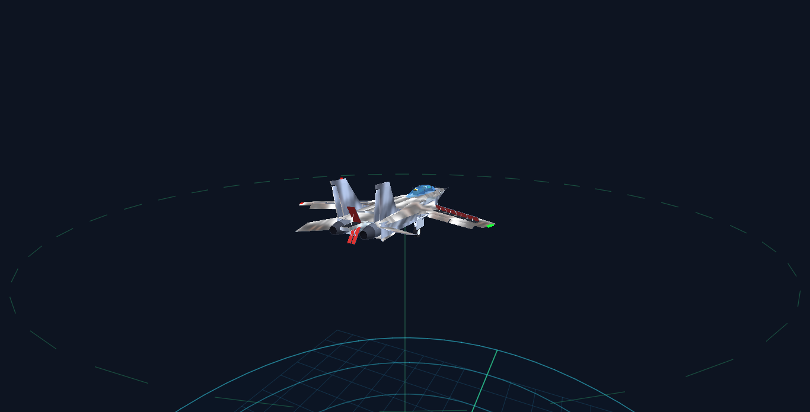
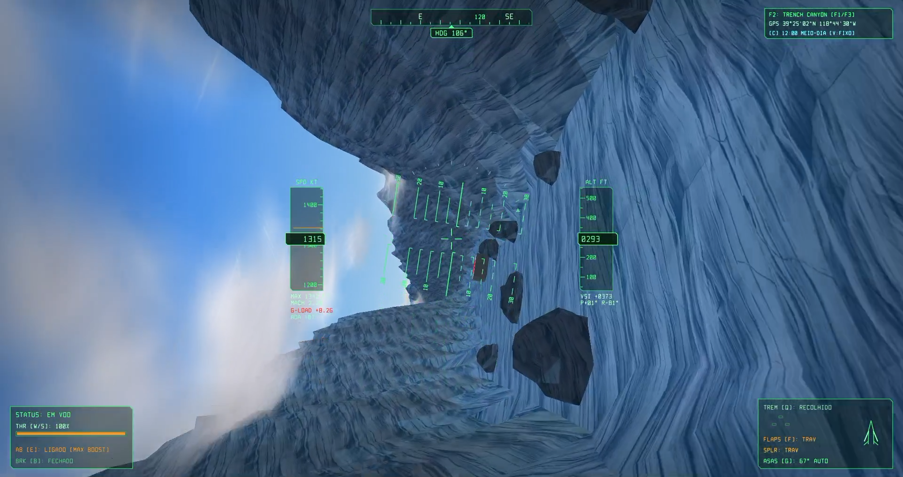
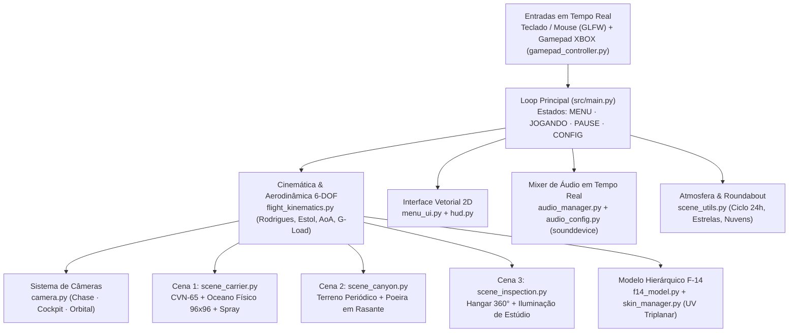

<div align="center">
  

  <h1>Top Graphics — F-14 Tomcat 3D Flight Simulator</h1>
  <p><strong>Simulador de voo 3D, hidrodinâmica em partículas, customização procedural de skins e motor de áudio em tempo real construídos do zero em Python + OpenGL.</strong></p>

  <p>
    <a href="https://github.com/JV-NC/TopGraphics/releases">
      
    </a>
    <a href="https://github.com/JV-NC/TopGraphics/actions/workflows/release.yml">
      
    </a>
    
    
    
    
  </p>

  <p>
    <a href="#-download-executáveis-prontos"><strong>Download</strong></a> ·
    <a href="#-galeria-do-simulador">Galeria</a> ·
    <a href="#-cenários-3d-e-ciclo-dianoite">Cenários 3D</a> ·
    <a href="#-modelagem-3d-e-aerodinâmica-do-f-14-tomcat">F-14 & Aerodinâmica</a> ·
    <a href="#-sistema-de-skins-e-hud-tático">Skins & HUD</a> ·
    <a href="#-motor-de-áudio-em-tempo-real">Áudio</a> ·
    <a href="#-controles-teclado-mouse-e-gamepad">Controles</a> ·
    <a href="#-arquitetura-do-projeto">Arquitetura</a> ·
    <a href="#-instalação-execução-e-build">Instalação & Build</a> ·
    <a href="#-inspiração-e-referências-3d">Inspiração</a> ·
    <a href="#-créditos-e-assets">Créditos</a> ·
    <a href="#-autor">Autor</a>
  </p>
</div>

---

## Visão Geral

**Top Graphics** é um simulador de voo 3D do caça naval **Grumman F-14 Tomcat**, desenvolvido em Python com **PyOpenGL**, **GLFW** e **NumPy** para a disciplina de **Computação Gráfica** do curso de Engenharia de Computação do **CEFET-MG (Campus Divinópolis)**.

Construído integralmente via código, sem uso de motores de jogos prontos (*game engines*), o projeto combina modelagem hierárquica 3D de alta fidelidade, física de voo 6-DOF livre de *Gimbal Lock*, sistemas de partículas hidrodinâmicas e arenosas vetorizados em NumPy, iluminação atmosférica com ciclo completo de 24 horas, customização de skins com mapeamento UV triplanar, suporte nativo a Gamepad padrão XBOX e um mixer de áudio em tempo real dedicado.

> **Destaques técnicos:**
> - **3 cenários jogáveis em mundo infinito (*Roundabout*):** Porta-Aviões USS Enterprise (CVN-65) em oceano físico, Cânion Procedural (*Trench Run*) com poeira em rasante e Hangar de Inspeção Técnica 360° para customização de skins.
> - **Aerodinâmica calibrada pelo F-14D Super Tomcat:** velocidade máxima de `1342 kt` ($\text{Mach } 2.34$ / $2485\text{ km/h}$), cálculo de Força G com vinheta periférica, ângulo de ataque ($\text{AoA}$), física real de estol (*nose-drop* e *wing-drop*) e superfícies móveis articuladas com travas por enflecamento das asas.
> - **Distribuição multiplataforma pronta para uso:** empacotamento automatizado via **PyInstaller** + **GitHub Actions** gerando binários independentes para **Windows (`.zip`)** e **Linux (`.tar.gz`)** com ícone personalizado.

---

## 📸 Galeria do Simulador

<table>
  <tr>
    <td align="center" width="50%">
      <br />
      <strong>Cena 1 — CVN-65 & Oceano Físico (Amanhecer)</strong><br />
      <sub>Ondas de Gerstner, esteira de Kelvin e decolagem no convés angulado.</sub>
    </td>
    <td align="center" width="50%">
      <br />
      <strong>Cena 2 — Cânion Procedural (Trench Run)</strong><br />
      <sub>Voo rasante levantando plumas de poeira arenítica e grãos balísticos.</sub>
    </td>
  </tr>
  <tr>
    <td align="center" width="50%">
      <br />
      <strong>Cena 3 — Hangar de Inspeção & Skins</strong><br />
      <sub>Câmera orbital 360°, 7 padrões de skin e 5 paletas de camuflagem.</sub>
    </td>
    <td align="center" width="50%">
      <br />
      <strong>Ciclo Dia/Noite — Operação Noturna</strong><br />
      <sub>420 estrelas, Lua cheia, reflexo lunar no mar e pós-combustão (<code>GL_LIGHT1</code>).</sub>
    </td>
  </tr>
</table>

---

## 📦 Download (Executáveis Prontos)

Não é necessário instalar Python ou dependências para jogar. Baixe o pacote compilado para o seu sistema operacional na aba [**Releases**](https://github.com/JV-NC/TopGraphics/releases):

| Sistema Operacional | Arquivo de Release | Como Executar |
| :--- | :--- | :--- |
| **Windows (x64)** | `TopGraphics-vX.Y.Z-Windows-x64.zip` | Extraia o `.zip` e execute `TopGraphics/TopGraphics.exe` (ícone multi-resolução embutido). |
| **Linux (x64)** | `TopGraphics-vX.Y.Z-Linux-x64.tar.gz` | Extraia com `tar -xzf TopGraphics-*.tar.gz` e execute `./TopGraphics/TopGraphics`. |

> **Atalho no menu de aplicativos (Linux):** dentro da pasta extraída, execute `./install_desktop_shortcut.sh` para registrar o simulador com o ícone `TopGraphics.png` no lançador do sistema.

---

## 🌍 Cenários 3D e Ciclo Dia/Noite

### Cena 1 — Oceano Físico de Partículas & USS Enterprise (CVN-65)
- **Corpo d'água híbrido Euleriano-Lagrangiano (`scene_carrier.py`):** grade acoplada de $96 \times 96$ partículas superficiais ($9.216$ vértices / $18.050$ triângulos via *OpenGL Client Arrays*) combinando 4 trens de ondas trocoidais de Gerstner com a Equação Diferencial da Onda 2D Amortecida.
- **Reações hidrodinâmicas em tempo real:** onda de proa (*Bow Wave*), esteira divergente de Kelvin e turbulência de popa do CVN-65; sopro supersônico (*Jet Blast / Downwash*) do F-14 em voo rasante ($Y < 38\text{ m}$) empurrando a superfície do mar e gerando plumas *Rooster Tail*; e até $1.800$ partículas livres 3D de spray, espuma e *splash* balístico em colisões aquáticas.
- **USS Enterprise CVN-65 (`cvn_65_model.py`):** convés de voo angulado texturizado, ilha nuclear SCANFAR, domo *Beehive*, mastro em treliça, guindaste, *Jet Blast Deflectors*, carena submersa (obra viva) para contato realista nos cavados das ondas e colisão poligonal precisa para pouso e frenagem no convés.

### Cena 2 — Cânion Procedural (*Trench Run*)
- **Terreno periódico $C^\infty$ (`scene_canyon.py`):** corredor sinuoso gerado por harmônicos exatos sobre o domínio $720\text{ m} \times 2000\text{ m}$ (costura imperceptível no mundo infinito *Roundabout*), revestido com `sandstone.png`, $34$ matacões 3D procedurais com colisão elipsoidal e bunker alvo ao final da trincheira.
- **Sistema de Partículas de Poeira e Areia (`CanyonDustSystem`):** até $1.600$ partículas vetorizadas em duas camadas físicas — plumas volumétricas expansivas em vórtices duplos e grãos balísticos sob gravidade real — disparadas automaticamente em rasantes abaixo de $38\text{ m}$ AGL, em curvas rente aos paredões laterais e em nuvens explosivas de impacto.

### Cena 3 — Hangar de Inspeção Técnica & Customização de Skins
- **Inspeção 360° desobstruída (`scene_inspection.py`):** F-14 suspenso em voo estacionário ($Y = 15\text{ m}$) com câmera orbital livre travada no Modo 3, plataforma tática rebaixada em $Y = -12\text{ m}$ com `glDepthMask(GL_FALSE)` (permitindo girar sob o ventre sem oclusão) e iluminação dupla de estúdio (*Key Light* superior + *Fill Light* inferior).
- **Testes interativos no hangar:** permite acionar superfícies móveis, trem de pouso, pós-combustores, enflecamento manual das asas e alternar skins/paletas em tempo real.

### Ciclo Dia/Noite Contínuo (24h)
- **Astronomia dinâmica (`scene_utils.py`):** ciclo completo de 24 horas a cada 6 minutos em modo automático (`[V]` alterna entre `AUTO` e `FIXO`) e 4 presets instantâneos pela tecla `[C]`:
  - **Amanhecer (`06:25`)** — Sol nascente a Leste ($-Z$) com horizonte dourado/âmbar.
  - **Meio-Dia (`12:00`)** — Sol alto ($+72^\circ$), céu azul cristalino e iluminação solar direta intensa.
  - **Pôr do Sol (`17:34`)** — Sol poente a Oeste ($+Z$) com degradê carmesim/laranja.
  - **Noite (`20:51`)** — Céu noturno com $420$ estrelas, Lua cheia com halo prateado, iluminação lunar calibrada para voo seguro e reflexo prateado sobre as ondas.
- **Integração global:** abóbada celeste esférica em *Display List* com cache inteligente, nuvens procedurais volumétricas tintadas em hardware e modulação automática do brilho das partículas de spray e poeira.

---

## ✈️ Modelagem 3D e Aerodinâmica do F-14 Tomcat

<p align="center">
  <br />
  <sub>Detalhe das superfícies articuladas: Wing Spoilers (4 painéis/asa), Trailing-Edge Flaps, Slats automáticos, Split Air Brakes no Beaver Tail, Tailerons diferenciais e Lemes duplos.</sub>
</p>

### Hierarquia Geométrica e Superfícies Móveis (`src/f14_model.py`)

| Componente | Especificação no Modelo 3D | Acoplamento Aerodinâmico / Regra Real |
| :--- | :--- | :--- |
| **Asas de Geometria Variável** | Enflecamento contínuo entre $20^\circ$ (aberta) e $68^\circ$ (supersônica), modo `AUTO` ou `MAN` (`[G]`). | Altera velocidade de estol e controla as travas mecânicas de Flaps e Spoilers. |
| **Wing Spoilers** | $4$ painéis articulados por asa no extradorso (até $55^\circ$), com baia interna, pintura vermelha naval e pistão hidráulico. | Auxiliam os tailerons na rolagem ($+0.85\text{ rad/s}$) e reduzem guinada adversa; **travados rentes à asa em enflecamento $\ge 57^\circ$**. |
| **Trailing-Edge Flaps** | $2$ painéis articulados por asa atrás dos spoilers (até $35^\circ$) com deslocamento Fowler e trilhos metálicos. | Reduzem a velocidade de estol de `195 kt` para `135 kt` e ampliam $\text{AoA}_{\text{crítico}}$ em $+4^\circ$; **recolhimento e trava automática em $\ge 26^\circ$**. |
| **Leading-Edge Slats** | $2$ seções automáticas por asa com avanço e *droop* de até $18^\circ$ sobre trilhos metálicos. | Operação automática via CADC (flaps, baixa velocidade ou alto $\text{AoA}$); recolhem entre $35^\circ$ e $50^\circ$. |
| **Split Air Brakes** | $1$ placa dorsal ($58^\circ$) + $2$ placas ventrais ($54^\circ$) no *Beaver Tail* com baia e pistões hidráulicos (`[B]`). | Forte desaceleração aerodinâmica em voo e frenagem adicional no convés. |
| **Tailerons & Lemes Duplos** | Estabilizadores horizontais diferenciais (arfagem + rolagem) e lemes verticais duplos (guinada). | Deflexão hidráulica suave sincronizada aos comandos de voo e ao eixo da roda de nariz no solo. |
| **Trem de Pouso & Armamento** | Trem triciclo retrátil (`[Q]`) com portas e farol + carga completa (`4x AIM-54`, `2x AIM-7`, `2x AIM-9`). | Trem baixado gera arrasto aerodinâmico e é obrigatório para pouso seguro no CVN-65. |

### Cinemática 6-DOF e Física Realista (`src/flight_kinematics.py`)

- **Base Ortonormal Livre de Gimbal Lock:** orientação mantida pelo triedro local $(\mathbf{F}, \mathbf{U}, \mathbf{R})$ atualizado via Fórmula de Rotação de Rodrigues:
  $$\mathbf{v}_{\text{rot}} = \mathbf{v}\cos\theta + (\mathbf{k} \times \mathbf{v})\sin\theta + \mathbf{k}(\mathbf{k} \cdot \mathbf{v})(1 - \cos\theta)$$
- **Desempenho Real F-14D:** empuxo militar seco até `780 kt` e pós-combustão máxima até **`1342 kt`** ($\text{Mach } 2.34$ / $2485\text{ km/h}$), com acelerações distintas entre empuxo seco, *Afterburner* e corrida de decolagem no convés.
- **Vetor Velocidade 3D, Sustentação e Estol Real:** integra empuxo, arrasto induzido, gravidade longitudinal/vertical e curva de sustentação dependente da velocidade e do $\text{AoA}$. Ao perder velocidade abaixo do estol ou exceder $\text{AoA}_{\text{crítico}}$ com o nariz alto, a aeronave perde autoridade de arfagem, cai sob gravidade real e sofre queda de nariz (*nose-drop*) e queda lateral de asa (*wing-drop*) até recuperar sustentação no mergulho.
- **Força G (`G-Load`):** calcula a carga normal sentida pelo piloto entre $-3.5\text{ G}$ e $+9.5\text{ G}$ combinando gravidade projetada e aceleração centrípeta das curvas, com drenagem de energia por arrasto induzido e vinheta visual progressiva de *G-LOC* ($> +6.2\text{ G}$) e *redout* ($< -1.6\text{ G}$).

---

## 🎨 Sistema de Skins e HUD Tático

### Customização de Skins com Mapeamento UV Triplanar (`src/skin_manager.py`)

Disponível em tempo real na **Cena 3** (`[K]` padrão / `[P]` paleta), o sistema aplica texturas `1024x1024` com mipmaps, **filtragem anisotrópica até 16x** e **projeção UV triplanar métrica** — garantindo texels quadrados sem estiramento ou cisalhamento em todas as chapas e superfícies móveis:

- **Padrão Original (1):** VF-84 Jolly Rogers (esquadrão naval clássico).
- **Acabamentos Metálicos (3):** Ouro Escovado (*Brushed Gold*), Prata Polido (*Polished Silver*) e Aço Negro Fosco (*Matte Black Steel*), cada um com material especular e *shininess* próprios.
- **Camuflagens Dinâmicas (3 padrões x 5 paletas = 15 combinações):** padrões **Digital**, **Tiger Stripe** e **Blobs** recoloridos em tempo real por substituição vetorial dos 4 canais de alto contraste (`R, G, B, K`) nas paletas **Arctic**, **Desert**, **Navy**, **Urban** e **Woodland**.

### HUD Vetorial e Interface (`src/hud.py`, `src/menu_ui.py`)

<p align="center">
  <br />
  <sub>HUD vetorial 100% OpenGL com fonte stroke própria, fita de bússola, horizonte artificial, telemetria de voo e menus interativos.</sub>
</p>

- **Zero dependências externas de fonte:** todos os textos são renderizados via fonte vetorial tática (`GL_LINES`).
- **Aviónica completa:** fita deslizante de bússola (`000`–`359`), coordenadas GPS dinâmicas, relógio solar (`[C]` / `[V]`), horizonte artificial com *Pitch Ladder* e escala de inclinação (*Bank Scale*), fitas deslizantes de Velocidade (`kt`, `MAX`, `MACH`, `G-LOAD`, `AOA`) e Altitude (`ft`, `VSI`, `P/R`), além de painéis inferiores com status de *Stall*, *Throttle*, *Afterburner*, *Air Brake*, luzes do trem de pouso, *Flaps*, *Wing Spoilers* e silhueta 2D animada do F-14.
- **Menus Integrados:** Menu Principal (seleção de cenários, configurações e sair), Menu de Pause (`ESC` / `START`) congelando a simulação e silenciando motores suavemente, e Tela de Configurações de Áudio com sliders independentes para `Master`, `SFX`, `Ambience` e `Music`.

---

## 🔊 Motor de Áudio em Tempo Real

Desenvolvido em `src/audio_manager.py` e `src/audio_config.py` sobre um único fluxo contínuo `sounddevice.OutputStream` (`44100 Hz` Estéreo) com mixagem em NumPy e proteção *soft-clipper* ($\tanh$):

- **Propulsão Bimotor em Camadas (Motores A e B):** 4 segmentos de *Jet Whine*, 4 de *Combustion* e 1 camada dedicada de *Afterburner* (`EFSC`) por motor com curvas trapezoidais suaves de *crossfade* em função do *throttle* e leve panorâmica estéreo (`-0.15` / `+0.15`).
- **Perspectiva Interna vs. Externa Automática:** alterna com *crossfade* suave entre amostras internas de cabine (Câmera 2) e externas (Câmeras 1 e 3).
- **DSP de Pré-Processamento em RAM:** recorte seletivo, concatenação com *crossfade*, remoção de DC offset, filtro passa-baixas RC para suavizar ignição/corte, *seamless loop crossfade* e **Time-Stretch OLA sem alterar pitch** para sincronizar `GEARDOWN.wav`/`GEARUP.wav` exatamente à animação do trem de pouso.
- **Efeitos Mecânicos, Colisões e Atmosfera:** loops hidráulicos sincronizados ao curso real dos **Flaps** (`FLAPS.wav`) e **Split Air Brakes** (canal independente a `1.18x`), toque no convés (`touchc.wav`), rolagem nas rodas com velocidade variável (`roll2.wav`), impacto sólido (`boom_crash.wav`) e aquático (`boom_crash.wav` + `water_splash.wav`), ambientes das Cenas 1 e 2 (`scene1.mp3`, `scene2.mp3`), trilhas musicais (`flight.mp3`, `menu_inspection.mp3`) e SFX de navegação de menu.

---

## 🎮 Controles (Teclado, Mouse e Gamepad)

Teclado/Mouse e **Gamepad padrão XBOX** funcionam **simultaneamente** (detecção plug-and-play nativa do SO via GLFW 3.3+, com suporte a *hot-plug*, zona morta exponencial e fallback para controles USB genéricos).

### Teclado e Mouse

| Entrada | Ação |
| :--- | :--- |
| **`W` / `S`** | Aumentar / Reduzir potência (*Throttle*); segurar **`S`** no convés aciona freios das rodas |
| **`Setas Cima` / `Baixo`** | Empurrar manche (mergulhar) / Puxar manche (subir / decolar) |
| **`Setas Esq` / `Dir`** | Rolagem (*Roll* — aciona Tailerons diferenciais e Wing Spoilers abaixo de $57^\circ$) |
| **`A` / `D`** | Guinada (*Yaw* — lemes duplos em voo / direção da roda de nariz no convés) |
| **`E`** | Ligar / Desligar Pós-Combustor (*Afterburner* — até `1342 kt` / $\text{Mach } 2.34$) |
| **`Q`** | Baixar / Recolher Trem de Pouso Retrátil |
| **`F`** | Estender / Recolher Trailing-Edge Flaps (trava automática em enflecamento $\ge 26^\circ$) |
| **`B`** | Abrir / Fechar Split Dorsal & Ventral Air Brakes no *Beaver Tail* |
| **`G`** | Alternar enflecamento das asas (`AUTO` <-> `MANUAL` $20^\circ$ / $68^\circ$) |
| **`1` / `2` / `3`** | Câmeras: `1` Chase Cam (Externa), `2` Cockpit (Interna), `3` Orbital 360° (Mouse + Scroll) |
| **`F1` / `F2` / `F3`** | Trocar diretamente entre Cena 1 (CVN-65), Cena 2 (Cânion) e Cena 3 (Inspeção) |
| **`C` / `V`** | Alternar preset Dia/Noite (`C`: Amanhecer / Meio-Dia / Pôr do Sol / Noite) / Fixar ciclo (`V`) |
| **`K` / `P`** | *(Apenas Cena 3)* Trocar padrão de Skin (`K`) e paleta de camuflagem (`P`) |
| **`H` / `R`** | Ocultar ou exibir HUD (`H`) / Reiniciar aeronave na cena atual (`R`) |
| **`M` / `N`** | Mute geral de áudio (`M`) / Mute apenas da trilha musical (`N`) |
| **`L` / `T` / `Z`** | Alternar Iluminação (`L`), Texturas UV (`T`) e Modo Wireframe (`Z`) |
| **`ESC`** | Abrir / Fechar Menu de Pause (e voltar nos menus) |

### Gamepad (Padrão XBOX — Detecção Automática via SO)

| Botão / Eixo (XBOX) | Em Jogo (Voo / Convés / Inspeção) | Menus (Principal / Pause / Config) |
| :--- | :--- | :--- |
| **`LS Y` / `LS X`** | Arfagem (*Pitch*) / Rolagem (*Roll*) | Navegar opções / Ajustar sliders |
| **`RT` / `LT`** | Aumentar / Reduzir *Throttle* (`LT` também freia no convés) | — |
| **`LB` / `RB`** | Guinada Esquerda / Guinada Direita | — |
| **`LS` (Clique)** | Toggle **Flaps** | — |
| **`RS X` / `RS Y`** | Girar **Câmera Orbital** (quando na Câmera 3) | — |
| **`RS` (Clique)** | Alternar **Câmera** (`1 -> 2 -> 3 -> 1`) | — |
| **`A`** | Toggle **Trem de Pouso** | Confirmar / Selecionar |
| **`B`** | Toggle **Split Air Brakes** | Voltar / Despausar |
| **`X`** | Toggle **Afterburner** | — |
| **`Y`** | Alternar **Cenas** (`1 -> 2 -> 3 -> 1`) | — |
| **`START` / `BACK`** | Abrir Menu de Pause (`START`) / Reiniciar Caça (`BACK`) | Fechar Pause (`START`) |
| **`D-Pad`** | **Cenas 1/2:** Cima = Dia/Noite, Baixo = Asas, Esq = HUD, Dir = Fixar Sol<br />**Cena 3:** Cima = Skin, Baixo = Paleta, Esq = HUD, Dir = Asas | Navegar opções e sliders |

---

## 🏗️ Arquitetura do Projeto

### Fluxo de Subsistemas



### Estrutura de Diretórios

```text
TopGraphics/
├── .github/
│   └── workflows/
│       └── release.yml               # CI/CD: build automático Windows + Linux e GitHub Releases
├── assets/
│   ├── icon.png                      # Ícone oficial (janela GLFW, .exe no Windows e .desktop no Linux)
│   ├── audio/
│   │   ├── aircraft/                 # Motores A/B internos/externos, EFSC, gear, flaps, crash, solo
│   │   ├── ambience/                 # scene1.mp3 (oceano) e scene2.mp3 (vento no cânion)
│   │   ├── menu/                     # menu1.wav, menu2.wav, menu3.wav
│   │   └── music/                    # flight.mp3 e menu_inspection.mp3
│   └── texture/                      # ocean_water, sandstone, skins metálicas e máscaras de camuflagem
├── docs/
│   └── media/                        # Banner, screenshots e GIFs utilizados neste README
├── src/
│   ├── main.py                       # Ponto de entrada, janela GLFW, ícone e orquestração do loop
│   ├── flight_kinematics.py          # Física 6-DOF, sustentação, estol, G-Load, flaps/spoilers/airbrakes
│   ├── f14_model.py                  # Geometria 3D hierárquica do F-14 Tomcat e superfícies móveis
│   ├── cvn_65_model.py               # Modelo 3D do Porta-Aviões USS Enterprise (CVN-65) e colisões
│   ├── scene_carrier.py              # Oceano físico (Gerstner + Onda 2D) e partículas de spray/esteira
│   ├── scene_canyon.py               # Cânion procedural periódico, rochas 3D e partículas de poeira
│   ├── scene_inspection.py           # Hangar de inspeção 360° e overlay exclusivo de skins
│   ├── scene_utils.py                # Ciclo Dia/Noite 24h, céu/estrelas, nuvens e teleporte Roundabout
│   ├── skin_manager.py               # Catálogo de skins metálicas, máscaras de camuflagem e cache GPU
│   ├── camera.py                     # Câmeras Chase, Cockpit e Orbital (mouse + gamepad RS)
│   ├── gamepad_controller.py         # Driver plug-and-play padrão XBOX via GLFW + navegação de menus
│   ├── hud.py                        # HUD vetorial tático, fonte stroke e vinheta de Força G
│   ├── menu_ui.py                    # Menu Principal, Menu de Pause e Configurações de Áudio
│   ├── audio_manager.py              # Mixer NumPy não-bloqueante, DSP OLA e resolução PyInstaller
│   ├── audio_config.py               # Catálogo de clips, envelopes de throttle e mapeamento de cenas
│   ├── renderer_utils.py             # Loader de texturas/ícones, mipmaps, Phong e primitivas 3D
│   └── math_utils.py                 # Operações vetoriais e cálculo de normais
├── build_release.py                  # Script PyInstaller multiplataforma (Windows .zip / Linux .tar.gz)
├── Makefile                          # Automação de venv, execução, builds e limpeza (Linux & Windows)
├── requirements.txt                  # Dependências Python
└── README.md
```

---

## 🛠️ Instalação, Execução e Build

### Pré-requisitos

- **Python 3.10+** (recomendado **Python 3.12**) e placa de vídeo com suporte a **OpenGL**.
- **No Linux (Ubuntu/Debian):** instale as bibliotecas de sistema necessárias ao OpenGL, GLFW e áudio:

```bash
sudo apt-get update
sudo apt-get install -y python3-venv make libgl1-mesa-dev libglu1-mesa-dev libportaudio2 libsndfile1 libxinerama1 libxcursor1 libxi6
```

### Executando a partir do Código-Fonte

```bash
# 1. Clonar o repositório
git clone https://github.com/JV-NC/TopGraphics.git
cd TopGraphics

# 2. Criar .venv e instalar dependências (requirements.txt)
make install

# 3. Iniciar o simulador (Menu Principal)
make run
```

Também é possível pular o Menu Principal iniciando diretamente em uma cena via CLI (`python src/main.py 1|2|3`) ou pelos alvos `make run1`, `make run2` e `make run3`.

### Comandos do `Makefile`

| Comando | Descrição |
| :--- | :--- |
| `make help` | Exibe o resumo de todos os comandos disponíveis. |
| `make venv` | Cria o ambiente virtual isolado em `.venv/`. |
| `make install` | Cria `.venv/` (se necessário) e instala as dependências de `requirements.txt`. |
| `make install-build` | Instala ou atualiza o **PyInstaller** no ambiente ativo. |
| `make run` | Executa o simulador iniciando no **Menu Principal**. |
| `make run1` / `run2` / `run3` | Inicia diretamente na Cena 1 (CVN-65), Cena 2 (Cânion) ou Cena 3 (Inspeção). |
| `make build [VERSION=v1.0.0]` | Compila executável otimizado (`--onedir`) + gera pacote `.zip`/`.tar.gz` em `release/`. |
| `make build-onefile [VERSION=v1.0.0]` | Compila executável único portátil (`--onefile`) + pacote em `release/`. |
| `make build-debug` | Compila com console aberto para visualização de logs de diagnóstico. |
| `make clean-build` | Remove artefatos temporários (`build/`, `dist/`, `*.spec`). |
| `make clean` | Limpa builds temporários, `release/` e caches `__pycache__`. |

### Compilação Local e Releases Automatizados (GitHub Actions)

O script `build_release.py` empacota automaticamente a pasta `assets/`, bibliotecas nativas (`GLFW`, `PyOpenGL`, `PortAudio`, `libsndfile`) e trata o ícone oficial (`assets/icon.png`) conforme o SO:
- **Windows:** converte automaticamente `assets/icon.png` para `.ico` multi-resolução ($16 \text{--} 256\text{ px}$) e embute no `.exe`.
- **Linux:** inclui `TopGraphics.png` ($256 \times 256$) e `install_desktop_shortcut.sh` dentro do `.tar.gz`.

Para gerar uma nova release oficial para **Windows e Linux simultaneamente** via `.github/workflows/release.yml`, basta criar e enviar uma tag semântica:

```bash
git tag v1.0.0
git push origin v1.0.0
```

O workflow também pode ser disparado manualmente na aba **Actions** (`workflow_dispatch`) para validar artefatos de teste antes da publicação.

---

## 💡 Inspiração e Referências 3D

Toda a geometria do simulador foi construída **100% em código OpenGL** (sem importação de malhas `.obj`/`.fbx`). Para guiar as proporções, silhuetas, seções transversais da fuselagem e detalhes estruturais dos dois principais modelos do projeto, foram utilizados como referência visual os seguintes modelos 3D no **Sketchfab**:

| Modelo no Simulador | Módulo em Código | Modelo Base de Referência (Sketchfab) |
| :--- | :--- | :--- |
| **Grumman F-14 Tomcat** | `src/f14_model.py` | [Low Poly F-14 Tomcat — Sketchfab](https://sketchfab.com/3d-models/low-poly-f14-tomcat-e99d03987b574e80971c1c8cc2b75925) |
| **USS Enterprise (CVN-65)** | `src/cvn_65_model.py` | [USS Enterprise CVN-65 Aircraft Carrier — Sketchfab](https://sketchfab.com/3d-models/uss-enterprise-cvn-65-aircraft-carrier-f1b46fa2de8f409cbbe693f7f10dc3b8) |

---

## 📜 Créditos e Assets

Os recursos visuais e sonoros de terceiros utilizados neste projeto acadêmico permanecem sujeitos às licenças de suas respectivas fontes originais.

### Texturas e Ícones

| Recurso | Uso no Projeto | Origem / Atribuição |
| :--- | :--- | :--- |
| **Arenito (`sandstone.png`)** | Terreno e paredões da Cena 2 (Cânion) | [Monochrome Sandstone Texture — Pngtree](https://pngtree.com/freepng/monochrome-sandstone-texture_17077567.html) |
| **Água Oceânica (`ocean_water.png`)** | Superfície física do oceano na Cena 1 | [Captivating Oceanic Water Texture — Pngtree](https://pngtree.com/freepng/captivating-oceanic-water-texture-transparent-background-overlay_15148040.html) |
| **Skins do F-14 e Ícone (`assets/icon.png`)** | Padrões metálicos, máscaras de camuflagem e ícone oficial da janela/executável | Gerados com Inteligência Artificial (**Gemini Hydrogen**) |

### Músicas

| Faixa | Uso no Projeto | Origem / Atribuição |
| :--- | :--- | :--- |
| **Trilha do Menu e Inspeção (`menu_inspection.mp3`)** | Menu Principal e Cena 3 (Hangar) | [Gamer Menu — Pixabay](https://pixabay.com/pt/music/jogos-de-v%C3%ADdeo-gamer-menu-431351/) |
| **Trilha de Voo (`flight.mp3`)** | Cenas 1 (Oceano/CVN-65) e 2 (Cânion) | [Danger Zone (Instrumental Version) — Hit Crew Masters](https://412284-hit-crew-masters.mp3.pm/song/76653820-danger-zone-instrumental-version/) |

### Sons Ambientes ([Sonniss #GameAudioGDC 2026](https://gdc.sonniss.com/))

| Ambiente | Arquivo / Biblioteca de Origem | Uso no Projeto |
| :--- | :--- | :--- |
| **Ambiente 1 (`scene1.mp3`)** | `WATRWave_Soft Waves Cliffs_JSE_RCoN_Stereo` *(Rocky Coast of Norway)* | Ondas e atmosfera marítima na Cena 1 |
| **Ambiente 2 (`scene2.mp3`)** | `WINDDsgn_EXT, Eye Of The Storm_344 Audio_Extreme Winds Vol 1` *(344 Audio — Extreme Winds Vol. 1)* | Ventos intensos na Cena 2 (Cânion) |

### Efeitos Sonoros (Aeronave, Colisões e Interface)

| Categoria | Recurso | Origem / Atribuição |
| :--- | :--- | :--- |
| **Aeronave F-14 Tomcat** | Turbinas A/B internas e externas, *Afterburner* (`EFSC`), partida/corte, trem de pouso, flaps, *air brakes*, *touchdown* e rolagem no convés | [FS2004 Grumman F-14 Tomcat Sound Pack — Fly Away Simulation](https://flyawaysimulation.com/downloads/files/2910/fs2004-grumman-f-14-tomcat-sound-pack/) *(motores gravados e editados por Christoffer Petersen)* |
| **Colisões / Impacto** | Explosão / impacto sólido (`boom_crash.wav`) | [Horror Boom Crash — Pixabay](https://pixabay.com/sound-effects/horror-boom-crash-487664/) |
| **Colisões / Impacto** | Impacto aquático / *splash* (`water_splash.wav`) | [Nature Water Splash Effect — Pixabay](https://pixabay.com/sound-effects/nature-water-splash-effect-443133/) |
| **Menus / Interface** | Confirmação / seleção (`menu1.wav`) | [Menu Click — Pixabay](https://pixabay.com/sound-effects/film-special-effects-menu-click-147357/) |
| **Menus / Interface** | Navegação e sliders (`menu2.wav`) | [UI Sound — Pixabay](https://pixabay.com/sound-effects/film-special-effects-ui-sound-374228/) |
| **Menus / Interface** | Abertura / fechamento do Pause (`menu3.wav`) | [UI Close SFX — Pixabay](https://pixabay.com/sound-effects/technology-ui-close-sfx-513359/) |

> Para detalhes sobre termos de licença e proveniência dos arquivos de áudio, consulte o documento [audio_credits.md](audio_credits.md).

---

## 👤 Autor

<table>
  <tr>
    <td align="center">
      <a href="https://github.com/JV-NC">
        <br />
        <strong>João Vitor Neves Costa</strong>
      </a><br />
      <sub>Engenharia de Computação — CEFET-MG (Campus Divinópolis)</sub><br /><br />
      <a href="https://github.com/JV-NC">
        
      </a>
      <a href="https://www.linkedin.com/in/joao-vitor-neves-costa">
        
      </a>
      <a href="mailto:joaovnevescosta@hotmail.com">
        
      </a>
    </td>
  </tr>
</table>